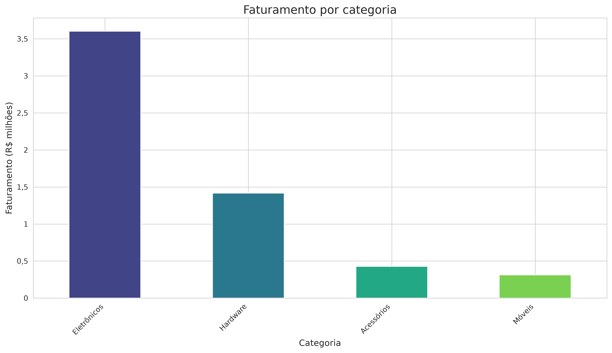
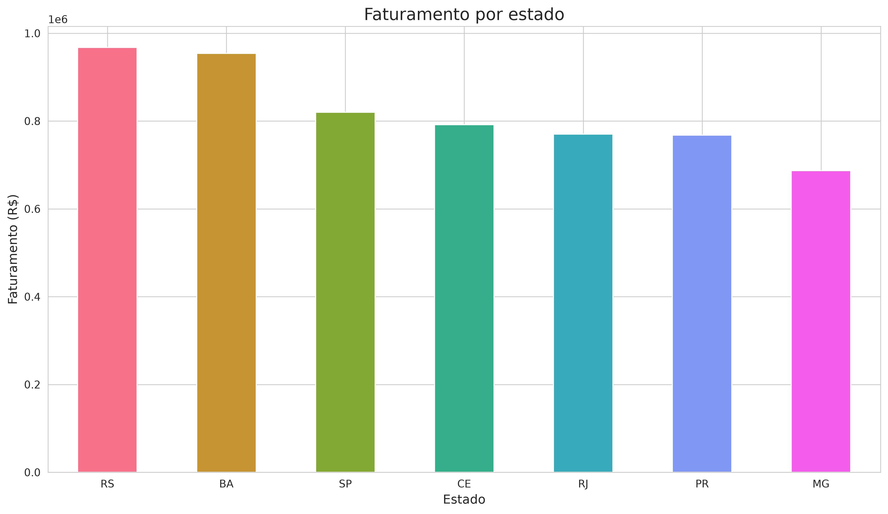
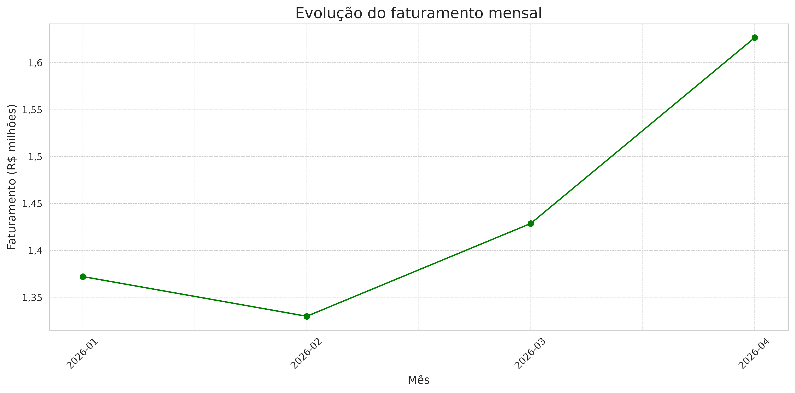
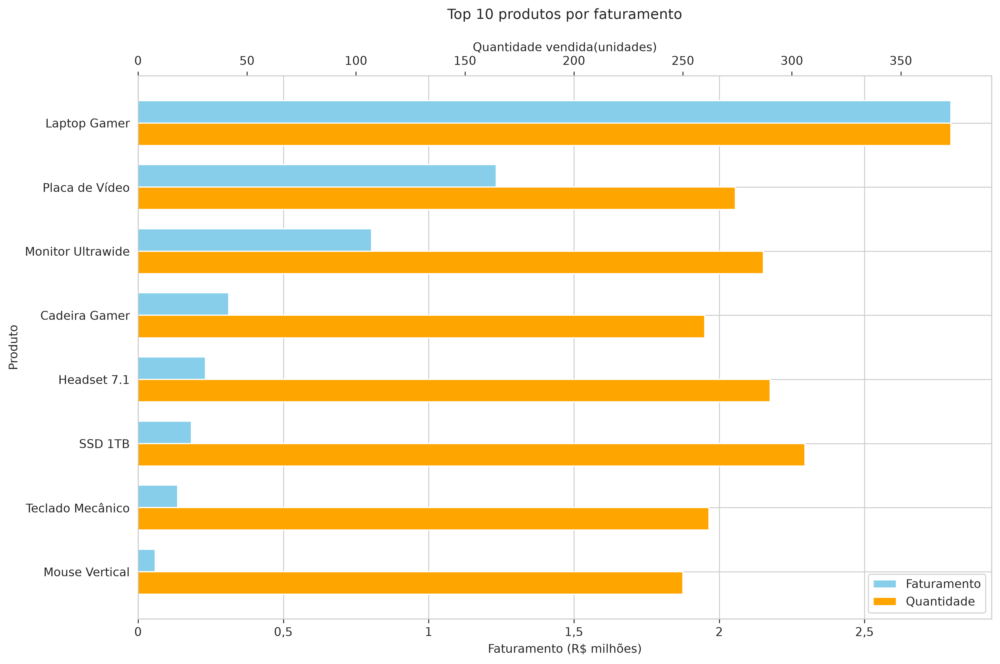

# Análise de dados com Python, Pandas e Matplotlib

Projeto de estudos para praticar manipulação e análise de dados com Python e Pandas e criação de gráficos com Matplotlib e Seaborn. O foco foi estudar a transformação de dados em métricas e visualizações que facilitem a leitura e a interpretação dos resultados de uma empresa.

Os dados são **inteiramente fictícios**, gerados aleatoriamente pelo módulo [db_generator.py](db_generator.py) e salvos em `vendas.csv`. Não representam vendas de uma empresa real.

## Ferramentas utilizadas

- **Python:** desenvolvimento dos scripts e automação da exportação dos gráficos.
- **Pandas:** leitura do CSV, tratamento dos dados e cálculo das métricas.
- **NumPy e random:** geração dos valores aleatórios da base fictícia.
- **Matplotlib:** criação, formatação e exportação dos gráficos em PNG.
- **Seaborn:** estilos e paletas de cores dos gráficos.

## Organização

- `db_generator.py`: gera a base fictícia.
- `processamento_vendas.py`: calcula o faturamento e adiciona o mês e a classificação de entrega.
- `vendas_categoria.py`, `vendas_estado.py`, `faturamento_mensal.py` e `top_10_produtos.py`: criam os gráficos das análises.
- `salvar_graficos.py`: executa os gráficos e salva os PNGs na pasta `imagens/`.

Para exportar todos os gráficos, com as dependências instaladas, execute na raiz do projeto:

```bash
python salvar_graficos.py
```

## Gráficos gerados

### Faturamento por categoria

[](imagens/vendas_categoria.png)

[Abrir imagem](imagens/vendas_categoria.png)

### Faturamento por estado

[](imagens/vendas_estado.png)

[Abrir imagem](imagens/vendas_estado.png)

### Faturamento mensal

[](imagens/faturamento_mensal.png)

[Abrir imagem](imagens/faturamento_mensal.png)

### Produtos por faturamento e quantidade vendida

O gráfico seleciona até dez produtos por faturamento; a base fictícia possui oito produtos distintos.

[](imagens/top_10_produtos.png)

[Abrir imagem](imagens/top_10_produtos.png)
